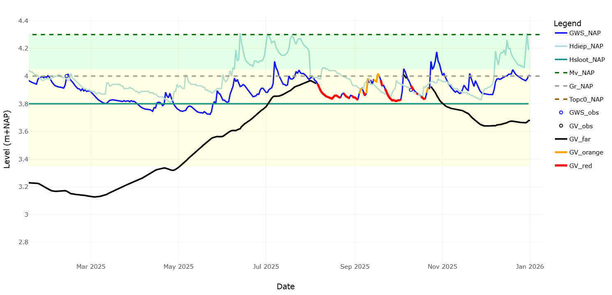

C.H. van Immerzeel

|                                |
|--------------------------------|
|  |

**lensFX** is een R Shiny-applicatie voor het simuleren en analyseren van de dynamiek van een *neerslaglens* in natte gebieden.  
De applicatie is gebaseerd op het klassieke neerslaglenzenmodel zoals toegepast in hydro‑ecologisch onderzoek, onder meer in het REGIWA‑project **De Zumpe** (Van Immerzeel et al., 1996).

Met lensFX kan het dynamische verloop worden berekend en gevisualiseerd van:

- de **freatische grondwaterstand (GWS)**  
- het **grensvlak tussen ondiep (regenwater) en diep (basenrijk) grondwater (GV)**  

op basis van tijdsafhankelijke externe belastingen (neerslagoverschot, slootpeilen en diepe stijghoogten).

---

## Achtergrond

In veel hydro‑ecologische herstelprojecten is het doel om basenrijk diep grondwater opnieuw in de wortelzone te laten doordringen. Conventionele grondwatermodellen leveren doorgaans wel informatie over kwelintensiteit, maar niet expliciet over de **hoogte van het scheidingsvlak** tussen diep en ondiep grondwater.

Het neerslaglenzenmodel overbrugt deze kloof door:

- een waterbalans op te stellen voor twee soorten verzadig grondwater: neerslagwater en diep grondwater,
- het niet‑stationaire verloop van de neerslaglens in de tijd te simuleren,
- de positie van het grensvlak te berekenen.

Het model is vooral geschikt voor **natte gebieden** zoals:

- beekdalen  
- laagvenen  
- broekbossen  
- polders  

Voor een uitgebreide theoretische onderbouwing en een casestudy wordt verwezen naar het artikel over **De Zumpe** (nabij Doetinchem).

---

## Functionaliteit

Met **lensFX** kun je:

- systeemparameters interactief instellen, waaronder:
  - maaiveldniveau  
  - porositeit en bergingscoëfficiënten  
  - drainage parameters  
- tijdreeksen van externe belastingen inlezen:
  - diepe stijghoogte  
  - slootpeil  
  - neerslagoverschot  
- het neerslaglenzenmodel niet‑stationair doorrekenen
- resultaten analyseren en visualiseren:
  - grondwaterstand (GWS)  
  - grensvlak diep/ondiep (GV)  
  - fluxen (drainage, kwel, afvoer)  
  - cumulatieve waterbalansen  
- invoer en uitvoer downloaden (Excel en RDS)

### Voorbeeldresultaat

De figuur bovenaan de pagina toont een typische uitvoer van lensFX met het berekende verloop van de grondwaterstand en het grensvlak.

In de figuur zijn onder andere weergegeven:

- berekende grondwaterstand **GWS**  
- berekende grensvlak **GV**  
- maaiveld, greppelniveau en slootpeil als referenties  

In de **oranje** delen van het berekende grensvlak niveau geldt:

- dat de dikte van de neerslaglens zeer gering is (< 1 cm), en
- dat het grensvlak zich in de zone bevindt waar in principe capillaire opstijging naar de wortelzone kan plaatsvinden.

In de **rode** delen van het berekende grensvlak niveau geldt:

- dat het grensvlak zich in de wortelzone bevindt **of**:
  - dat de dikte van de neerslaglens zeer gering is (< 1 cm), **en**
  - dat het grensvlak zich in de zone bevindt waar in principe capillaire opstijging naar de wortelzone kan plaatsvinden **en**
  - dat er een negatief neerslagoverschot is.

Kortom: de oranje en rode delen van de grensvlak lijn geven perioden weer dat de wortelzone van de vegetatie mogelijk kan profiteren van de kwaliteit van het diepe grondwater.

---

## Modelopzet (beknopt)

Het model onderscheidt twee watervoorraden:

- **A** – neerslaglens (recent geïnfiltreerd regenwater)  
- **B** – diep grondwater onder het grensvlak  

Belangrijke aannames:

- geen menging tussen beide waterpakketten  
- lineaire relatie tussen vochtinhoud en grondwaterstand  
- afvoer naar greppels en sloten is afhankelijk van het niveauverschil  
- geldig voor kwelgedomineerde, natte systemen  

De dynamiek wordt per tijdstap opgelost met `deSolve`.  
Na elke tijdstap worden correcties toegepast om fysieke randvoorwaarden te garanderen (zoals een niet‑negatieve dikte van de neerslaglens en een grensvlak boven de onderrand van het model).

---

## Link to the app
<https://sweco.shinyapps.io/lensFX/>

## Source code
R-source code van de app:

<https://github.com/KeesVanImmerzeel/lensFX>

## Referenties
- Immerzeel, C.H. van (1996). Toepassing van een neerslaglenzenmodel bij hydro-ecologische herstelprojecten. H2O (29) 1996, nr.10, blz. 293-296.

